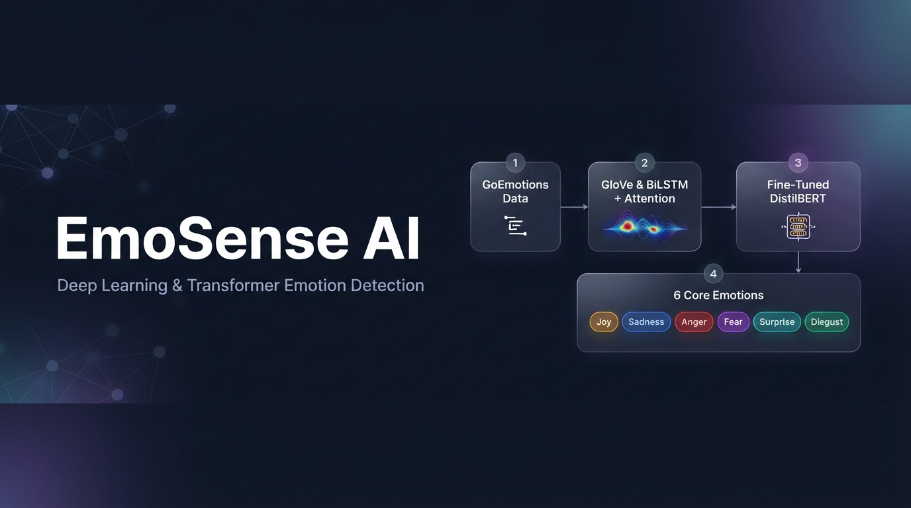

# 🎭 EmoSense AI: Multi-Class Emotion Classification with Attention & Transformers

### 📌 Project Overview
**EmoSense AI** is an end-to-end Natural Language Processing (NLP) pipeline designed to classify English text into **six core Ekman emotions**: **Joy, Sadness, Anger, Fear, Surprise, and Disgust**. The project systematically compares traditional recurrent architectures against self-attention mechanisms and fine-tuned Transformers, concluding with an interactive **Gradio** web application.

---

### 🗂️ Dataset & Preprocessing
* **Source:** [GoEmotions Dataset](https://huggingface.co) (Google Research).
* **Label Mapping:** Mapped 27 fine-grained emotion labels into 6 primary Ekman classes while filtering out neutral/ambiguous samples.
* **Class Imbalance Handling:** Applied inverse class weights (`compute_class_weight`) within `CrossEntropyLoss` to ensure balanced recall across minority classes (`fear`, `disgust`).
* **Embeddings:** Initialized sequence models with pre-trained 100d **GloVe** vectors (`glove-wiki-gigaword-100`).

---

### 📊 Experimental Results (Test Set)

| Model Architecture | Test Accuracy | Test Macro F1 | Key Highlights |
| :--- | :---: | :---: | :--- |
| **GRU** | 66.32% | 0.5730 | Masked mean pooling over hidden states |
| **LSTM** | 68.73% | 0.5852 | Outperforms GRU on sequential context |
| **BiLSTM + Attention** | 70.34% | 0.6083 | Custom attention layer highlights emotional keywords |
| **DistilBERT (Fine-Tuned)** | **77.88%** | **0.6910** | Best overall accuracy and minority-class F1 |

---

### 🔍 Key Features & Deliverables
* **Model Interpretability:** Visualized token-level **Attention Heatmaps** from the `BiLSTM + Attention` model to explain which words drive each emotion prediction.
* **Comprehensive Evaluation:** Evaluated all 4 architectures using Accuracy, Macro F1, Per-Class Precision/Recall, and Confusion Matrices.
* **Interactive Web App:** Deployed the fine-tuned `DistilBERT` model using **Gradio**, displaying the dominant emotion card and a 6-class confidence distribution chart.

---

### 🚀 How to Run
1. Click the **Open In Kaggle** badge above to view the full execution logs, attention heatmaps, and confusion matrices.
2. Or download `emosense-emotion-classification.ipynb` from this repository and run it on any GPU-enabled Jupyter environment.
